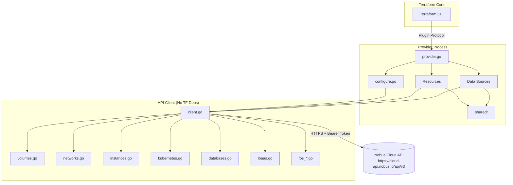

# Architecture Documentation

This document describes the architectural design, patterns, and conventions used in the Nobus Terraform provider.

## Overview

The provider follows a **clean architecture** with a strict separation between:
- **API Client** (`internal/client/`) - Pure Go HTTP client with no Terraform dependencies
- **Provider Layer** (`internal/provider/`) - Terraform Plugin Framework implementation
- **Shared Helpers** (`internal/provider/shared/`) - Cross-cutting concerns

```
terraform-provider-nobus/
├── main.go                          # Entry point, serves provider
├── internal/
│   ├── client/                      # Nobus API client (no Terraform deps)
│   │   ├── client.go                # Transport, auth, JSON, polling
│   │   ├── errors.go                # Error types, not-found detection
│   │   ├── *_paths.go               # Centralized endpoint constants
│   │   ├── *_helpers.go             # Shared request/response patterns
│   │   └── *.go                     # One file per API collection
│   └── provider/                    # Terraform Plugin Framework
│       ├── provider.go              # Provider assembly & registration
│       ├── configure.go             # Client construction & config resolution
│       ├── shared/                  # Config, schema, conversion helpers
│       ├── networking/              # Network resources & data sources
│       ├── storage/                 # Block storage resources
│       ├── fos/                     # File/Object Storage (FOS)
│       ├── kubernetes/              # Managed Kubernetes
│       ├── database/                # Managed databases
│       ├── lbaas/                   # Load Balancer as a Service
│       ├── datasources/             # Cross-service collection data sources
│       └── *.go                     # Core resources (network, volume, instance, etc.)
├── docs/                            # Generated documentation (tfplugindocs)
├── examples/                        # Usage examples
└── docs/api/openapi.json            # Vendored OpenAPI spec
```

## Design Principles

### 1. API Client Independence
The `internal/client/` package contains **zero Terraform dependencies**. It can be:
- Unit tested with `httptest` servers
- Reused in other Go programs
- Developed and released independently

### 2. One File Per API Collection
Each Nobus API collection (e.g., volumes, networks, instances) maps to exactly one client file:
- `volumes.go` - All volume operations
- `networks.go` - All network operations
- `instances.go` - All instance operations

This makes it trivial to find the implementation for any API endpoint.

### 3. Centralized Endpoint Paths
All API paths are defined as constants in `*_paths.go` files:
- `networking_paths.go` - Networking endpoints
- `storage_paths.go` - Block storage endpoints

Changing an API path requires editing exactly one file.

### 4. Resource-per-File in Provider Layer
Each Terraform resource lives in its own file:
- `<name>_resource.go` - Complete CRUD lifecycle
- `<name>_data_source.go` - Singular data source
- `<name>_resource_helpers.go` - Models/conversions shared only by that resource

### 5. Service-Based Organization
Provider resources are grouped by service domain:
```
networking/  → networks, subnets, routers, ports, security, QoS, firewalls
storage/     → snapshots, volume types, transfers, backups
fos/         → containers, objects, listings, downloads
kubernetes/  → clusters, scaling, migration, access
database/    → databases, actions, credentials, logs
lbaas/       → load balancers, listeners, pools, members, L7 policies
```

## Provider Configuration Flow

```
Provider Block (HCL)
        │
        ▼
NobusProvider.Configure()
        │
        ├── Reads provider config (api_key, endpoint, project_id, availability_zone)
        ├── Falls back to environment variables (NOBUS_*)
        ├── Constructs internal/client.Client
        └── Stores shared.Config in ResourceData/DataSourceData
                │
                ▼
        Every Resource/DataSource receives shared.Config via:
        providerConfigFromResourceData(ctx, req, resp)
```

### Configuration Resolution Order
For `api_key`, `endpoint`, `project_id`, `availability_zone`:
1. Provider block attribute (explicit)
2. Environment variable (`NOBUS_API_KEY`, `NOBUS_ENDPOINT`, `NOBUS_PROJECT_ID`, `NOBUS_AVAILABILITY_ZONE`)
3. Hard-coded defaults (endpoint: `https://cloud-api.nobus.io`, availability_zone: `nobus-wa-az1`)

## Resource Lifecycle Patterns

### Async Resource Handling
Many Nobus operations are asynchronous (create, delete, resize). The provider uses a **polling pattern**:

```go
// In client package
func (c *Client) WaitFor(ctx context.Context, interval time.Duration, condition func(context.Context) (bool, error)) error

// In resource Create/Update/Delete
err := client.WaitFor(ctx, 2*time.Second, func(ctx context.Context) (bool, error) {
    obj, err := c.Read(ctx, id)
    if err != nil { return false, err }
    return obj.Status == "ACTIVE", nil
})
```

**Default poll interval**: 2 seconds (configurable per resource)
**No hard timeout** - respects Terraform context cancellation

### State Mapping
Each resource defines:
- **Terraform schema** (`schema.Schema` with `MarkdownDescription`)
- **State model** (struct with `tfsdk` tags)
- **API request/response models** (in `internal/client/`)
- **Conversion functions** (in `_resource_helpers.go` or `shared/converters.go`)

```go
// Typical pattern
func (r *VolumeResource) Create(ctx context.Context, req resource.CreateRequest, resp *resource.CreateResponse) {
    var plan VolumeModel
    resp.Diagnostics.Append(req.Plan.Get(ctx, &plan)...)
    
    apiReq := plan.toAPIRequest()
    apiResp, err := r.client.CreateVolume(ctx, apiReq)
    if err != nil { ... }
    
    state := VolumeModelFromAPI(apiResp)
    resp.Diagnostics.Append(resp.State.Set(ctx, &state)...)
}
```

### Import Support
Every resource implements `ImportState`:
```go
func (r *VolumeResource) ImportState(ctx context.Context, req resource.ImportStateRequest, resp *resource.ImportStateResponse) {
    // Nobus IDs are globally unique, but API reads require project_id + availability_zone
    // These come from provider configuration
    resource.ImportStatePassthroughID(ctx, path.Root("id"), req, resp)
}
```

Composite IDs (e.g., volume attachment): `INSTANCE_ID/VOLUME_ID`

## Data Source Patterns

### Collection Data Sources
Generic plural data sources (e.g., `nobus_networks`, `nobus_volumes`) are generated by a **factory**:

```go
// datasources/collection_data_sources.go
func NewCollectionDataSource(collectionName string) func() datasource.DataSource {
    return func() datasource.DataSource {
        return &CollectionDataSource{
            collection: collectionName,
        }
    }
}
```

The factory receives the collection name and uses the corresponding client method.

### Singular Data Sources
Specific lookup data sources (e.g., `nobus_volume_backup`, `nobus_database_credentials`) have dedicated implementations with their own schema and read logic.

### Sensitive Data
Data sources returning credentials, tokens, or keys mark results as `Sensitive: true` in schema:
```go
"password": schema.StringAttribute{
    Sensitive: true,
    Computed:  true,
}
```

## Error Handling

### API Errors
Nobus API wraps responses: `{"status": bool, "data": ..., "message": string}`

Client translates to typed errors:
```go
// client/errors.go
type APIError struct {
    Method     string
    Path       string
    StatusCode int
    Message    string
}

func (e *APIError) Error() string {
    return fmt.Sprintf("Nobus API returned HTTP %d: %s", e.StatusCode, e.Message)
}
```

### Not Found Detection
Resources implement `isNotFound(err error) bool` to distinguish 404 from other errors during Read:
```go
func isNotFound(err error) bool {
    var apiErr *APIError
    return errors.As(err, &apiErr) && apiErr.StatusCode == 404
}
```

### Terraform Diagnostics
All errors become Terraform diagnostics preserving the original API message:
```
Error: Unable to create Nobus instance "api-01"
  with nobus_instance.api,
  on main.tf line 2:
   2: resource "nobus_instance" "api" {

The Nobus API returned HTTP 400: requested image is unavailable in the selected availability zone.
```

## Testing Strategy

### Unit Tests (No Infrastructure)
- **Client tests**: `internal/client/*_test.go` - Use `httptest` servers
- **Provider tests**: `internal/provider/*_test.go` - Test schema, conversion, logic
- Run: `go test ./...`

### Acceptance Tests (Real API)
- **Tagged with**: `TF_ACC=1`
- **Require**: Real Nobus credentials via environment variables
- **Location**: `internal/provider/acceptance_test.go`
- Run: `TF_ACC=1 go test ./internal/provider/ -run TestAcc -v -timeout 120m`

Required env vars:
```bash
export NOBUS_API_KEY="..."
export NOBUS_PROJECT_ID="..."
export NOBUS_TEST_IMAGE="ubuntu-22-04"
export NOBUS_TEST_FLAVOR="small"
export NOBUS_TEST_KEY_NAME="operations"
```

## Code Generation

### Documentation
Documentation is **auto-generated** from source code using `tfplugindocs`:
```bash
go install github.com/hashicorp/terraform-plugin-docs/cmd/tfplugindocs@latest
tfplugindocs generate
```
Output: `docs/resources/*.md`, `docs/data-sources/*.md`, `docs/index.md`

### OpenAPI Spec
The vendored `docs/api/openapi.json` is the **source of truth** for API contracts. All request/response models in `internal/client/` are derived from this spec.

## Adding a New Resource

1. **Add client methods** in `internal/client/<collection>.go`
2. **Add endpoint constants** in appropriate `*_paths.go`
3. **Create resource file** in `internal/provider/<service>/<name>_resource.go`
4. **Register** in `provider.go` `Resources()` function
5. **Add tests** in `internal/provider/<service>/<name>_resource_test.go`
6. **Generate docs**: `tfplugindocs generate`

## Versioning & Release

- **Version** set by goreleaser at build time (injected into `main.go`)
- **Changelog**: Maintained manually in `CHANGELOG.md`
- **Release**: Tagged releases trigger goreleaser to build and publish to Terraform Registry

## Security Considerations

- API key marked `Sensitive: true` in provider schema
- Never logged, never written to state
- Credential-bearing data source results marked `Sensitive: true`
- TLS enforced (HTTPS only)
- User-Agent identifies provider for API analytics

## Extensibility Points

| Extension | Location |
|-----------|----------|
| New API collection | `internal/client/<name>.go` + `*_paths.go` |
| New resource type | `internal/provider/<service>/<name>_resource.go` |
| New data source | `internal/provider/<service>/<name>_data_source.go` or `datasources/` |
| Shared conversion logic | `internal/provider/shared/converters.go` |
| Shared schema patterns | `internal/provider/shared/schema.go` |
| Resource helpers | `internal/provider/shared/resource_helpers.go` |

## Diagram

